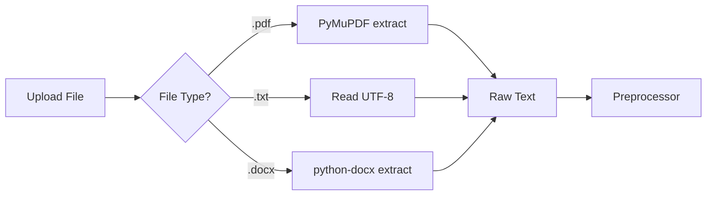
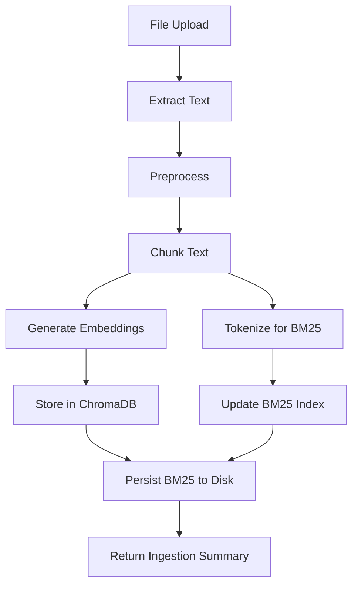
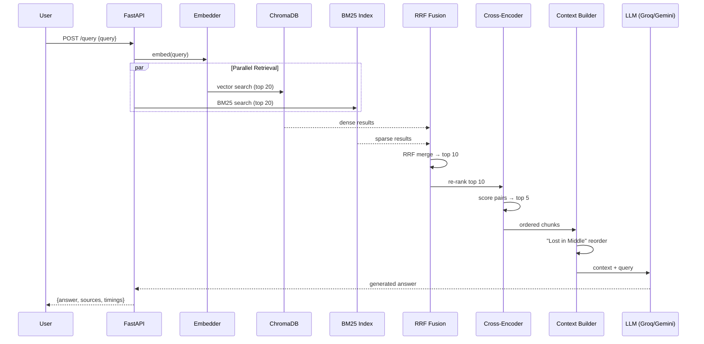
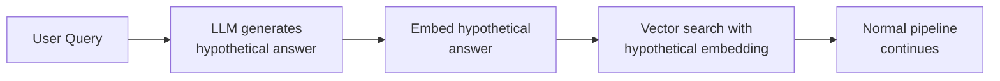
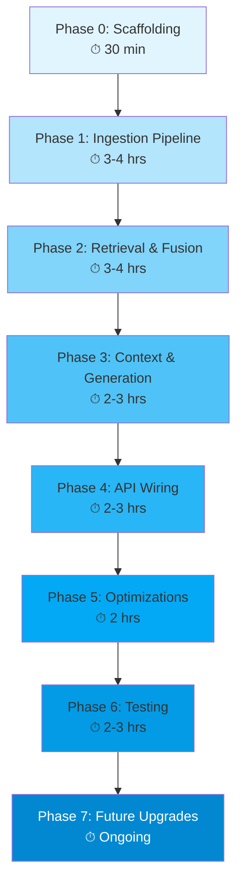

# 🚀 FusionRAG — Production Hybrid-Search RAG Engine

## Implementation Plan

> **Goal:** Build a production-grade RAG engine that combines **Dense Vector Search** (semantic) + **BM25 Sparse Search** (lexical) with **Reciprocal Rank Fusion** and **Cross-Encoder Re-Ranking**, served via FastAPI.

---

## Phase 0 — Project Scaffolding & Environment Setup
**Estimated Time: 30 mins**

### 0.1 Directory Structure

```
d:\Projects\FusionRAG\
├── app/
│   ├── __init__.py
│   ├── main.py                    # FastAPI entry point
│   ├── config.py                  # Settings via pydantic-settings
│   ├── dependencies.py            # Dependency injection (DB clients, models)
│   │
│   ├── api/
│   │   ├── __init__.py
│   │   ├── routes/
│   │   │   ├── __init__.py
│   │   │   ├── ingest.py          # POST /ingest — document upload & processing
│   │   │   ├── query.py           # POST /query — hybrid search + LLM answer
│   │   │   └── health.py          # GET /health
│   │   └── schemas/
│   │       ├── __init__.py
│   │       ├── ingest.py          # Request/Response models for ingestion
│   │       └── query.py           # Request/Response models for queries
│   │
│   ├── core/
│   │   ├── __init__.py
│   │   ├── chunker.py             # Recursive character text splitter
│   │   ├── embedder.py            # Sentence-Transformer embedding wrapper
│   │   ├── bm25_index.py          # BM25 sparse index manager
│   │   ├── vector_store.py        # ChromaDB operations wrapper
│   │   ├── retriever.py           # Dual retrieval orchestrator
│   │   ├── fusion.py              # Reciprocal Rank Fusion (RRF) algorithm
│   │   ├── reranker.py            # Cross-Encoder re-ranking
│   │   ├── context_builder.py     # "Lost in the Middle" ordering
│   │   └── generator.py           # LLM response generation (Groq/Gemini)
│   │
│   ├── ingestion/
│   │   ├── __init__.py
│   │   ├── pipeline.py            # End-to-end ingestion orchestrator
│   │   ├── extractors/
│   │   │   ├── __init__.py
│   │   │   ├── pdf_extractor.py   # PDF text extraction
│   │   │   ├── txt_extractor.py   # Plain text extraction
│   │   │   └── docx_extractor.py  # DOCX extraction
│   │   └── preprocessor.py        # Text cleaning & normalization
│   │
│   └── utils/
│       ├── __init__.py
│       ├── logger.py              # Structured logging setup
│       └── timing.py              # Performance timing decorator
│
├── data/
│   ├── chroma_db/                 # ChromaDB persistent storage
│   └── bm25_index/                # Pickled BM25 index storage
│
├── tests/
│   ├── __init__.py
│   ├── conftest.py                # Shared fixtures
│   ├── test_chunker.py
│   ├── test_fusion.py
│   ├── test_reranker.py
│   ├── test_retriever.py
│   └── test_api/
│       ├── test_ingest.py
│       └── test_query.py
│
├── scripts/
│   └── benchmark.py               # Latency & accuracy benchmarks
│
├── .env.example                   # Template for environment variables
├── pyproject.toml                 # Project metadata & dependencies
├── README.md
└── Dockerfile                     # (Future) Containerization
```

### 0.2 Dependencies (`pyproject.toml`)

| Package | Purpose | Version |
|---|---|---|
| `fastapi` | Web framework | ≥0.115 |
| `uvicorn[standard]` | ASGI server | ≥0.30 |
| `chromadb` | Vector database | ≥0.5 |
| `sentence-transformers` | Embeddings + Cross-encoder | ≥3.0 |
| `rank-bm25` | BM25 sparse retrieval | ≥0.2.2 |
| `python-multipart` | File uploads | ≥0.0.9 |
| `pydantic-settings` | Config management | ≥2.0 |
| `PyPDF2` / `pymupdf` | PDF text extraction | latest |
| `python-docx` | DOCX extraction | latest |
| `httpx` | Async HTTP client (Groq/Gemini API) | ≥0.27 |
| `sse-starlette` | Server-Sent Events streaming | ≥2.0 |
| `pytest` + `pytest-asyncio` | Testing | latest |

### 0.3 Config Management (`config.py`)

```python
class Settings(BaseSettings):
    # Embedding model
    EMBEDDING_MODEL: str = "all-MiniLM-L6-v2"
    CROSS_ENCODER_MODEL: str = "cross-encoder/ms-marco-MiniLM-L-6-v2"

    # Chunking
    CHUNK_SIZE: int = 512
    CHUNK_OVERLAP: int = 50

    # Retrieval
    DENSE_TOP_K: int = 20
    BM25_TOP_K: int = 20
    RRF_K: int = 60
    FUSION_TOP_N: int = 10        # Post-fusion candidates for cross-encoder
    FINAL_TOP_N: int = 5          # Final chunks to LLM

    # ChromaDB
    CHROMA_PERSIST_DIR: str = "./data/chroma_db"
    CHROMA_COLLECTION: str = "fusionrag_docs"

    # LLM
    LLM_PROVIDER: str = "groq"    # "groq" | "gemini"
    GROQ_API_KEY: str = ""
    GEMINI_API_KEY: str = ""
    LLM_MODEL: str = "llama-3.3-70b-versatile"
    LLM_MAX_TOKENS: int = 1024

    model_config = SettingsConfigDict(env_file=".env")
```

> [!TIP]
> Keep all magic numbers in `Settings` so they're tunable without code changes. This is interview-gold — shows production thinking.

---

## Phase 1 — Hybrid Ingestion Pipeline
**Estimated Time: 3–4 hours**

### 1.1 Text Extraction (`ingestion/extractors/`)



**Tasks:**
1. Build a `TextExtractor` protocol/ABC with a `.extract(file_bytes) -> str` method.
2. Implement `PdfExtractor`, `TxtExtractor`, `DocxExtractor`.
3. Create a factory function `get_extractor(content_type: str) -> TextExtractor`.
4. Add a `Preprocessor` class: strip excessive whitespace, normalize unicode, remove headers/footers heuristics.

### 1.2 Semantic Chunking (`core/chunker.py`)

**Algorithm: Recursive Character Text Splitter**

**Tasks:**
1. Implement `RecursiveChunker` class with configurable `chunk_size` and `chunk_overlap`.
2. Split hierarchy: `\n\n` → `\n` → `. ` → ` ` → character-level.
3. Each chunk gets metadata: `{"doc_id": str, "chunk_index": int, "source_file": str, "char_start": int, "char_end": int}`.
4. Return `List[Chunk]` where `Chunk` is a Pydantic model.

> [!IMPORTANT]
> **Chunk overlap** is critical — without it you lose context at boundaries. 50–100 chars is the sweet spot for 512-char chunks.

### 1.3 Dense Vector Store (`core/vector_store.py` + `core/embedder.py`)

**Tasks:**
1. **Embedder:** Wrap `SentenceTransformer("all-MiniLM-L6-v2")` with lazy model loading (load on first call, cache in module). Expose `embed(texts: List[str]) -> List[List[float]]`. Batch encode for throughput.
2. **VectorStore:** Wrap ChromaDB client.
   - `add_chunks(chunks: List[Chunk])` — embed and upsert.
   - `search(query_embedding: List[float], top_k: int) -> List[ScoredChunk]`.
   - Use persistent storage at `CHROMA_PERSIST_DIR`.
   - Store chunk text + metadata in ChromaDB's metadata field.

### 1.4 BM25 Sparse Index (`core/bm25_index.py`)

**Tasks:**
1. Maintain an in-memory `BM25Okapi` index over tokenized chunk texts.
2. **Tokenization:** Lowercase → split on whitespace/punctuation → optional stopword removal. Keep it simple — BM25's strength is exact keyword match, aggressive stemming hurts that.
3. Persistence: Pickle the tokenized corpus + `BM25Okapi` object to `data/bm25_index/`. Reload on startup.
4. `search(query: str, top_k: int) -> List[ScoredChunk]`.
5. **Important:** Maintain a parallel `chunk_id → chunk_text` mapping so you can return full chunk content.

### 1.5 Ingestion Orchestrator (`ingestion/pipeline.py`)



**Tasks:**
1. Wire together: extract → preprocess → chunk → parallel(embed+store, bm25_index).
2. Return summary: `{doc_id, filename, total_chunks, status}`.
3. Handle duplicates: check `doc_id` before re-ingesting.

---

## Phase 2 — Dual Retrieval & Fusion
**Estimated Time: 3–4 hours**

### 2.1 Dual Retriever (`core/retriever.py`)

**Tasks:**
1. Implement `DualRetriever` that runs both searches:
   ```python
   async def retrieve(query: str) -> Tuple[List[ScoredChunk], List[ScoredChunk]]:
       dense_task = asyncio.create_task(self.vector_store.search(query_emb, top_k=20))
       bm25_task  = asyncio.create_task(asyncio.to_thread(self.bm25_index.search, query, top_k=20))
       dense_results, bm25_results = await asyncio.gather(dense_task, bm25_task)
       return dense_results, bm25_results
   ```
2. Key: BM25 is CPU-bound → wrap in `asyncio.to_thread()` to avoid blocking the event loop.

> [!NOTE]
> **Interview Edge Case — Latency Budget:** This `asyncio.gather()` pattern is the exact answer. Two 50ms searches run in ~55ms instead of 100ms sequentially.

### 2.2 Reciprocal Rank Fusion (`core/fusion.py`)

**Algorithm:**

$$RRF\_Score(d) = \sum_{m \in M} \frac{1}{k + r_m(d)}$$

Where $k = 60$ (constant) and $r_m(d)$ = rank of document $d$ in ranking $m$.

**Tasks:**
1. Implement pure function:
   ```python
   def reciprocal_rank_fusion(
       ranked_lists: List[List[ScoredChunk]],
       k: int = 60,
       top_n: int = 10
   ) -> List[ScoredChunk]:
   ```
2. Logic:
   - Create a `dict[chunk_id, float]` score accumulator.
   - For each ranked list, iterate with enumerated rank (1-indexed).
   - Add `1 / (k + rank)` to each chunk's accumulated score.
   - Sort by accumulated score descending → return top-N.
3. **Unit test this heavily** — it's a pure function, easy to test with mock data.

### 2.3 Cross-Encoder Re-Ranking (`core/reranker.py`)

**Tasks:**
1. Load `CrossEncoder("cross-encoder/ms-marco-MiniLM-L-6-v2")` lazily.
2. Implement:
   ```python
   def rerank(query: str, chunks: List[ScoredChunk], top_n: int = 5) -> List[ScoredChunk]:
       pairs = [(query, chunk.text) for chunk in chunks]
       scores = self.model.predict(pairs)
       # Attach scores, sort descending, return top_n
   ```
3. **Limit input to 10 candidates max** (from RRF output) — cross-encoder is the latency bottleneck (~10-30ms per pair).

> [!WARNING]
> Cross-encoders are **not symmetric** — `predict(query, doc)` ≠ `predict(doc, query)`. Always put the query first.

---

## Phase 3 — Context Building & LLM Generation
**Estimated Time: 2–3 hours**

### 3.1 Context Ordering — "Lost in the Middle" Fix (`core/context_builder.py`)

**Problem:** LLMs attend better to the **beginning** and **end** of the context window, ignoring the middle.

**Algorithm:**
```
Given re-ranked chunks [1, 2, 3, 4, 5] (best → worst):
Reorder to: [1, 3, 5, 4, 2]
 - Odd-indexed (by rank) go to the top (ascending rank)
 - Even-indexed go to the bottom (descending rank)
Result: Best chunks are at the TOP and BOTTOM of context.
```

**Tasks:**
1. Implement `build_context(chunks: List[ScoredChunk]) -> str`:
   - Apply the interleaving reorder.
   - Format each chunk with source metadata: `[Source: {filename}, Chunk {idx}]\n{text}\n---`.
   - Return concatenated string.

### 3.2 LLM Response Generator (`core/generator.py`)

**Tasks:**
1. Abstract `LLMProvider` protocol:
   - `async def generate(prompt: str, context: str, query: str) -> str`
   - `async def generate_stream(prompt: str, context: str, query: str) -> AsyncIterator[str]`
2. Implement `GroqProvider` — uses `httpx.AsyncClient` to call Groq API.
3. Implement `GeminiProvider` — uses `httpx.AsyncClient` to call Gemini API.
4. **System prompt template:**
   ```
   You are a helpful assistant. Answer the user's question based ONLY on the
   provided context. If the context doesn't contain enough information, say so.
   Do not make up information.

   Context:
   {context}

   Question: {query}
   ```
5. Factory: `get_provider(name: str) -> LLMProvider`.

---

## Phase 4 — FastAPI Endpoints & Wiring
**Estimated Time: 2–3 hours**

### 4.1 API Routes

#### `POST /ingest`
```
Request:  multipart/form-data { file: UploadFile }
Response: { doc_id, filename, chunks_created, status }
```

#### `POST /query`
```
Request:  { "query": str, "stream": bool = false }
Response: {
  "answer": str,
  "sources": [ { chunk_id, text_preview, source_file, relevance_score } ],
  "timings": { retrieval_ms, fusion_ms, rerank_ms, generation_ms, total_ms }
}
```

#### `GET /query/stream` (SSE)
```
Request:  query param ?q=...
Response: SSE stream of { "event": "token", "data": "..." }
          Final event: { "event": "sources", "data": [...] }
```

#### `GET /health`
```
Response: { status, chroma_docs_count, bm25_index_size, models_loaded }
```

### 4.2 Full Query Pipeline Flow



### 4.3 Dependency Injection (`dependencies.py`)

**Tasks:**
1. Use FastAPI's `Depends()` pattern for injecting:
   - `Embedder` (singleton, loaded once at startup)
   - `VectorStore` (singleton)
   - `BM25Index` (singleton)
   - `CrossEncoderReranker` (singleton)
   - `LLMProvider` (singleton)
2. Load all models at startup in a `@app.on_event("startup")` or `lifespan` handler.
3. This avoids cold-start on first request.

---

## Phase 5 — Performance Optimizations
**Estimated Time: 2 hours**

### 5.1 Latency Optimizations

| Optimization | Where | Impact |
|---|---|---|
| `asyncio.gather()` for dual retrieval | `retriever.py` | ~50% retrieval time saved |
| Limit cross-encoder to top 10 | `reranker.py` | Caps re-rank at ~100-300ms |
| Model preloading at startup | `dependencies.py` | Eliminates cold-start |
| Batch embedding for ingestion | `embedder.py` | 5-10x ingestion throughput |
| Connection pooling for LLM API | `generator.py` | Reuse TCP connections |

### 5.2 Timing Instrumentation (`utils/timing.py`)

**Tasks:**
1. Build a `@timed` decorator that records `perf_counter` durations.
2. Collect timings per pipeline stage and return in API response.
3. This is essential for identifying bottlenecks in production.

---

## Phase 6 — Testing Strategy
**Estimated Time: 2–3 hours**

### 6.1 Unit Tests

| Test File | What It Tests |
|---|---|
| `test_chunker.py` | Chunk sizes, overlap correctness, edge cases (empty doc, single char) |
| `test_fusion.py` | RRF math correctness, tie-breaking, single-list input, empty lists |
| `test_reranker.py` | Score ordering, top-N truncation, empty input handling |
| `test_retriever.py` | Both retrievers return results, parallel execution works |

### 6.2 Integration Tests

| Test File | What It Tests |
|---|---|
| `test_ingest.py` | Full upload → chunk → store pipeline via API |
| `test_query.py` | Full query → retrieval → fusion → rerank → response pipeline |

### 6.3 Benchmark Script (`scripts/benchmark.py`)

- Ingest a sample corpus (e.g., 50 markdown docs).
- Run 20 queries measuring P50/P95/P99 latency.
- Compare: vector-only vs. BM25-only vs. hybrid (proves hybrid value).

---

## Phase 7 — Future Upgrades (Post-MVP)
**Estimated Time: Varies**

### 7.1 HyDE — Hypothetical Document Embeddings



**Idea:** Instead of embedding the *question*, embed a *hypothetical answer* — this matches document embeddings better because docs contain answers, not questions.

### 7.2 SSE Streaming

- Use `sse-starlette`'s `EventSourceResponse`.
- Stream LLM tokens as they arrive.
- Send final `sources` event after generation completes.

### 7.3 Query Expansion

- Generate 3 query variants via LLM.
- Run retrieval for each variant.
- Fuse all result lists via RRF (now 6 lists instead of 2).

### 7.4 Metadata Filtering

- Add pre-retrieval filters: by source file, date range, document type.
- ChromaDB supports `where` filters natively.

### 7.5 Caching Layer

- Cache frequent queries → skip retrieval entirely.
- Use query embedding similarity to match cache (not exact string match).

---

## Implementation Order & Timeline



| Phase | Estimated Time | Deliverable |
|---|---|---|
| Phase 0 | 30 min | Project skeleton, dependencies installed |
| Phase 1 | 3–4 hrs | Documents can be ingested, chunked, and stored in both indexes |
| Phase 2 | 3–4 hrs | Hybrid retrieval returns fused + re-ranked results |
| Phase 3 | 2–3 hrs | LLM generates answers with properly ordered context |
| Phase 4 | 2–3 hrs | Working API endpoints, full pipeline wired |
| Phase 5 | 2 hrs | Async parallelization, timing instrumentation |
| Phase 6 | 2–3 hrs | Unit + integration tests, benchmark script |
| **Total MVP** | **~15–20 hrs** | **Production-ready hybrid RAG engine** |

---

## Key Interview Talking Points

> [!IMPORTANT]
> These are the differentiators that separate this from a basic RAG tutorial project:

1. **"Why hybrid?"** — Vector search misses exact keywords (model numbers, error codes). BM25 misses semantic meaning. Hybrid catches both. Give the `ERR_404_AUTH` example.

2. **"Why RRF over simple score normalization?"** — RRF is rank-based, not score-based. Different retrieval systems have incompatible score scales. RRF only cares about *position*, making it robust.

3. **"Why Cross-Encoder?"** — Bi-encoders (used for retrieval) encode query and doc independently — fast but less accurate. Cross-encoders process the (query, doc) pair jointly — slower but much more precise. Use cross-encoders as a *second stage* on a small candidate set.

4. **"Lost in the Middle?"** — Liu et al. (2023) showed LLMs degrade when relevant info is in the middle of context. Solution: place highest-ranked chunks at the start and end.

5. **"Latency?"** — `asyncio.gather()` for parallel retrieval, cross-encoder limited to top-10, model preloading at startup, batch embeddings for ingestion.

